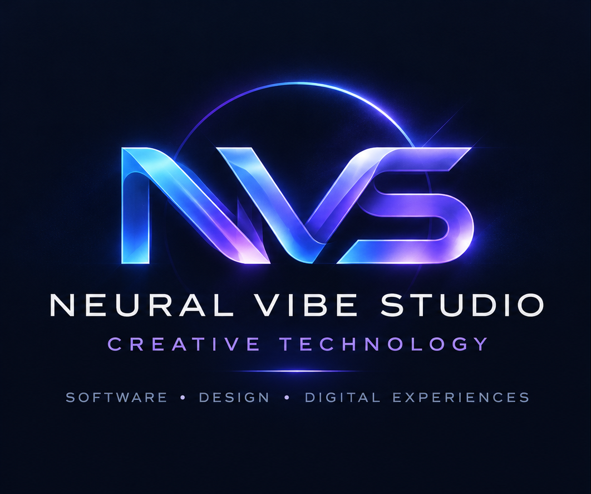

<h1>Neural Vibe Studio</h1>

<strong>CREATIVE TECHNOLOGY</strong>

<em>Software • Design • Digital Experiences</em>

<h3>Technology meets creativity.</h3>

Neural Vibe Studio (NVS) is an independent creative technology studio
focused on software engineering, digital design, and innovative digital experiences.

We bring together technology, creativity, and thoughtful design to build
intuitive, high-performance digital products that are made to evolve.

<h3>What We Do</h3>

<strong>Software Development</strong> 
Modern websites, applications, digital platforms, and scalable software solutions.

<strong>UI/UX &amp; Digital Design</strong> 
Intuitive interfaces, cohesive visual systems, and meaningful user experiences.

<strong>Creative Technology</strong> 
Exploring new possibilities at the intersection of technology, design, and interactive media.

<strong>Digital Ecosystems</strong> 
Building connected, maintainable digital experiences across platforms and devices.

<h3>Our Philosophy</h3>

We believe technology should be powerful, intuitive, and purposeful.

Our approach combines creative thinking with engineering discipline,
prioritizing performance, accessibility, security, and long-term maintainability.

We focus on building digital solutions that balance technical excellence
with distinctive design.

<strong>Neural Vibe Studio — Creative Technology</strong>

<em>Building digital experiences with purpose.</em>

